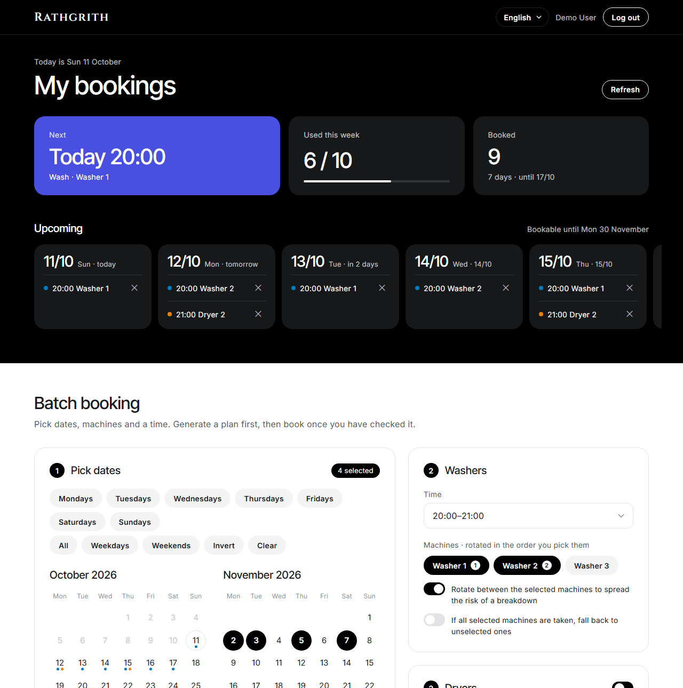
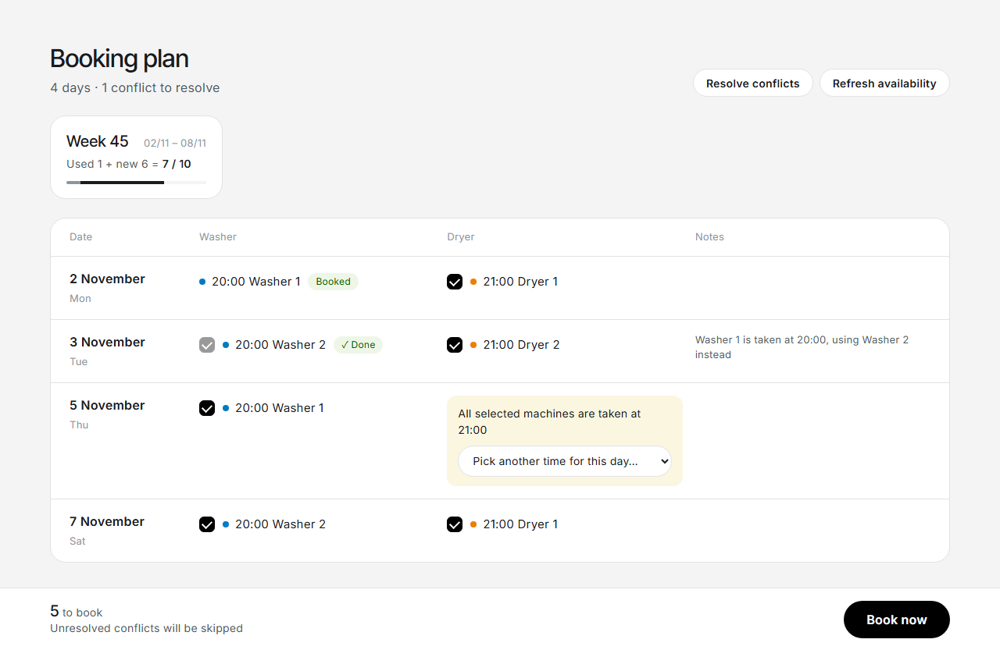
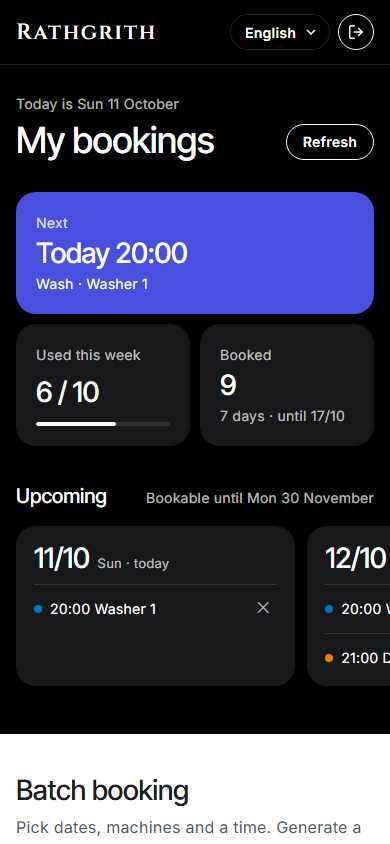

# Rathgrith

**Batch-book laundry machines and dryers on [HOAS](https://booking.hoas.fi) — in one go, instead of one slot at a time.**

HOAS opens the next month's laundry slots all at once, and booking a whole month through the official site means
dozens of clicks: pick a day, pick a machine, pick a time, confirm, repeat. Rathgrith lets you pick all the days
you want on a calendar, choose your machines and time once, review a plan, and book everything with a single click.

> Unofficial project. Not affiliated with HOAS or Tampuuri. You sign in with your own HOAS account and the tool
> only does what you could do by hand on booking.hoas.fi.

**[Try the live demo →](https://iroshiki.github.io/Rathgrith/)** No HOAS account needed: the demo runs
entirely in your browser with sample data and never books anything.



<table>
  <tr>
    <td width="72%"></td>
    <td width="28%"></td>
  </tr>
</table>

## Features

- **Pick many dates at once** — a multi-select calendar: click, drag across days, Shift+click a range,
  click a month name for the whole month, or use shortcuts such as *every Monday*, *weekdays* or *weekends*.
- **Spread the risk across machines** — select several washers and Rathgrith rotates between them, so a single
  broken machine does not take out all of your bookings.
- **Smart fallbacks** — if your machine is taken at that hour, another selected machine at the same hour is used.
  If all of them are taken, the day is flagged and you get a list of free slots to pick from, or let
  *Resolve conflicts* choose the closest free time for every day in one click.
- **Dryers included** — automatically book a dryer for the hour after each wash (the offset is adjustable),
  optionally also during the washing hour, and preferably the same dryer for consecutive hours.
- **Weekly quota aware** — washers and dryers share a limit of 10 bookings per week. The plan shows how much of
  each week you have used and leaves anything over the limit unchecked, so you decide what to keep.
- **Plan first, then book** — nothing is booked until you have reviewed the plan. Each booking is then verified
  by re-reading the timetable, because the HOAS site itself never says whether a booking succeeded.
- **Overview at a glance** — your next booking, this week's usage and all upcoming bookings, each cancellable
  with one click.
- **Four languages** — English, Suomi, 中文 and 日本語, picked from your browser language and switchable at any time.
- **Works on your phone** — responsive layout and dark mode.
- **Private by design** — your password is only forwarded to HOAS and never stored. The login session lives in an
  encrypted, HttpOnly cookie in *your* browser; the server keeps no state and no database, so several people can
  use the same deployment without seeing each other's data.

## Quick start (local)

You need **Python 3.11+** and [**uv**](https://docs.astral.sh/uv/getting-started/installation/).

```bash
git clone https://github.com/iroShiki/Rathgrith.git
cd Rathgrith
uv run hoas
```

The app opens at <http://127.0.0.1:8765>. Sign in with your booking.hoas.fi username and password.

Without uv:

```bash
python -m venv .venv
source .venv/bin/activate        # Windows: .venv\Scripts\activate
pip install .
python -m hoas
```

## Configuration

All settings are optional environment variables.

| Variable | Default | Description |
|---|---|---|
| `HOAS_WASH_SERVICE_ID` | `509` | ID of your building's laundry room (see below). |
| `HOAS_DRY_SERVICE_ID` | `629` | ID of your building's dryer room. |
| `HOAS_SECRET_KEY` | random per start | Key used to encrypt the login cookie. **Required when deployed**; locally a random key is generated on each start, so you sign in again after a restart. |
| `HOAS_HOST` / `HOAS_PORT` | `127.0.0.1` / `8765` | Where the local server listens. |

**Finding your building's IDs:** sign in at [booking.hoas.fi](https://booking.hoas.fi), open your laundry room
and look at the address bar: in `.../varaus/service/timetable/509/...` the number after `timetable/` is the
laundry room ID. Do the same for the dryer room. Machine IDs are discovered automatically.

## Deploy to Vercel (free)

The app is a small Flask server and runs on Vercel's free Hobby plan as a Python function.

1. Fork or push this repository to your GitHub account.
2. In [Vercel](https://vercel.com/new), import the repository. No build settings are needed — the entry point is
   declared in `pyproject.toml` (`[tool.vercel] entrypoint = "hoas.server:app"`).
3. Add an environment variable `HOAS_SECRET_KEY` with a long random value, for example the output of
   `python -c "import secrets; print(secrets.token_urlsafe(48))"`. Add the service ID variables too if your
   building is not the default one.
4. Deploy. Keep the secret key the same across deployments; changing it signs everyone out.

Generating a plan reads one timetable page per selected day and service, so planning a whole month can take
15–30 seconds. If you lower the function's maximum duration in Vercel, keep it above that.

> **Host it for yourself.** Anyone who signs in to a deployment types their HOAS password into that server.
> Deploy your own copy rather than asking others to trust yours.

## Demo on GitHub Pages (free)

GitHub Pages only serves static files, so the demo replaces the Python backend with an in-browser mock
(`demo/demo.js`): sample timetables, a JavaScript port of the planner and bookings that live only in your browser
tab. The interface is exactly the same as the real app.

The workflow in `.github/workflows/pages.yml` publishes the demo on every push to `main`. To enable it once:
**Settings → Pages → Build and deployment → Source: GitHub Actions**. The demo then appears at
`https://iroshiki.github.io/Rathgrith/`.

To build and preview it locally:

```bash
python scripts/build_demo.py
python -m http.server -d _site 8000
```

## How it works

booking.hoas.fi is a server-rendered site without a public API, so Rathgrith signs in like a browser and reads the
timetable HTML. Booking is a plain request to the same link the site's *Vacant* button uses; afterwards the
timetable is fetched again to confirm the slot is now yours. The endpoints are documented in [API.md](API.md)
(in Chinese).

```
hoas/client.py         HOAS client: login, timetable parsing, reserve, cancel
hoas/planner.py        Pure planning logic (rotation, fallbacks, dryers, conflicts)
hoas/server.py         Flask app and the /api/* endpoints
hoas/auth.py           Encrypted per-browser session cookie
hoas/static/           Frontend (plain HTML/CSS/JS, translations in i18n.js)
demo/demo.js           In-browser mock backend for the GitHub Pages demo
scripts/build_demo.py  Builds the static demo site into _site/
```

## Development

```bash
uv run pytest
```

Translations live in `hoas/static/i18n.js`. The backend returns errors, notes and conflict reasons as
`{code, params}` and the frontend translates them, so adding a language only touches that file.

The demo's planner in `demo/demo.js` is a port of `hoas/planner.py`. `tests/test_demo_parity.py` runs both on
hundreds of random timetables and checks that they produce identical plans (it needs Node.js and is skipped
without it), so change both together.

Pull requests for new languages or other HOAS buildings are welcome.

## Responsible use

- Slots are first come, first served. Book what you will actually use and cancel what you will not —
  cancellations less than 12 hours before the start still count towards your weekly limit.
- Rathgrith keeps the load on HOAS low: at most four timetable pages are read in parallel and bookings are
  made one by one with a short pause in between.
- If HOAS changes its website, parts of the tool may stop working until the parser is updated.

## License

[MIT](LICENSE)
